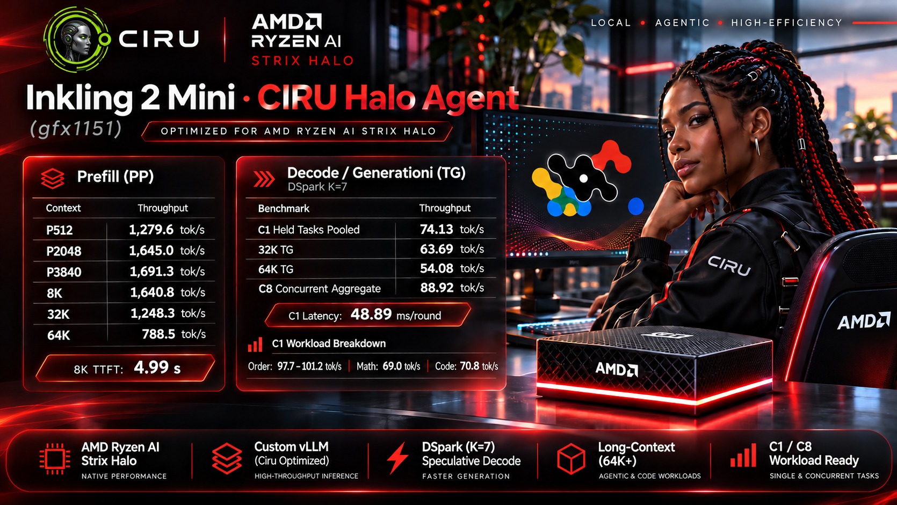

# Inkling 2 Mini · CIRU Halo Agent (gfx1151)

Run Thinking Machines Lab's Inkling 2 Mini locally on **AMD Ryzen AI Max+ 395 with Radeon 8060S (`gfx1151`)**. With **v1.4.0**, the default `./serve.sh` launch delivers native RDNA 3.5 HIP prefill acceleration alongside our fast adaptive speculative decoding stack out of the box—no hidden flags and no vision speed penalty: **2,229.9 client / 2,363.0 server prompt tokens/s** at 4K (**+52% over v1.3.1**, **2,199.6–2,247.9 tok/s at 8K**, **1,944.9–2,006.1 tok/s at 32K**, **1,762.3–1,815.3 tok/s at 58K**, all with zero prefix-cache hits), **93–100+ decode tokens/s** on short-context single-request serving (`B=1`, `T=0`), and **244–316+ aggregate output tokens/s** across eight concurrent requests (**3.5× faster** than v1.2.2's `88.92 tok/s`) from one adaptive server. The OpenAI-compatible API accepts text and images, enables prefix caching, streams reasoning, supports native tool calling, defaults to a **1,048,576-token context** on 128 GB Strix Halo, and idles at **~0.5–1.4% of one CPU core**.



*Measured on AMD Ryzen AI Max+ 395 / Radeon 8060S (`gfx1151`, 128 GB unified memory) with CIRU v1.4.0 and adaptive DSpark speculative decoding. See the tables and scaling notes below for exact v1.4.0 warm zero-cache prefill (`1K–58K`), long-context decode (`32K–72K+`), multi-agent bursts, and `T > 0` sampling.*

---

## Release notes

### v1.4.0 — Native RDNA 3.5 HIP Prefill Kernels (2,230 Client / 2,363 Server tok/s at 4K, +52% Faster Prefill)
- **Native `gfx1151` HIP paired-`M128` + `M64`-tail K64 WMMA MoE prefill (`ops/hip_moe_prefill.hip`):** Replaces Triton/Gluon prefill MoE with native RDNA 3.5 WMMA kernels supporting all three Inkling quant formats (`source` NVFP4, `mixed` INT4/C1, and `coda` C1), direct BF16 activation loads on `w13`, hardware `exp2f` SwiGLU, zero-cast FP16 `w13 → w2` handoff, and a warp-parallel block scanner—cutting all 48 MoE prefill layers by **`~388 ms`** per 4K chunk (`1,273.5 ms → 894.3 ms`).
- **Prebuilt portable `gfx1151` binary + automatic JIT/fallback:** Bundles a zero-`RUNPATH`, `GLIBC_2.2.5`-compatible prebuilt binary (`scripts/rocm/hip_moe_prefill_gfx1151_80df0ef12be2.so`) verified by `MANIFEST.sha256` so every user gets the full `v1.4.0` prefill speedup out of the box without needing `hipcc` or `rocm-sdk-devel`, while still auto-JIT compiling from source if modified and falling back cleanly to Gluon/Triton if unavailable.
- **1-warp zero-barrier HIP K/V short-conv (`hip_kv_conv_1warp_kernel`):** Fuses static (local) and dynamic (global) K and V 4-tap depthwise convolutions + L2-clip / RMSNorm into one single-read, `uint2`-coalesced register-ring-buffer kernel (`0.00000` bit-exact vs. Triton), cutting K/V conv by **`3.7×`** (`92.9 ms → 25.2 ms` per 4K chunk).
- **Zero-materialization loop message blend (`hip_attn_res_q4_coeffs_kernel` + `_fused_loop_zeromat_kernel`):** Eliminates allocating and writing the 141.6 MB FP32 `messages` tensor per loop layer by computing exact `[4, T, 2]` coefficients directly from BF16 bank tensors and blending with a cache-aligned `(streams, token_blocks)` grid—cutting loop-controller + Q4 AttnRes by **`2.75×`** (`195.2 ms → 70.9 ms`).
- **Scalar-page `BLOCK_N=16` prefill attention & fused BF16-WMMA router:** Matches `BLOCK_N=16` to paged KV loads (`208.5 ms → 166.9 ms`, `-41.7 ms`, accelerating `1K–64K` local and near-window global attention) and replaces the FP32 router prefill cast + SGEMM with a fused BF16-WMMA → FP32 kernel (`29.9 ms → 5.6 ms`, **`5.4×`**).
- **Zero regression on decode, vision, or quality:** Retains full adaptive `K=7 @ B=1 / K=4 @ B=2..8` FULL HIP graphs, native ROCm vision, prefix caching, 8 slots, and 1M context in the default `./serve.sh` launch. **Model and fitted weight files (`WEIGHTS.sha256`) are unchanged from v1.3.x.** [v1.4.0 release](https://github.com/ciru-ai/Inkling-2-Mini-CIRU-Halo-Agent-gfx1151/releases/tag/v1.4.0)

### v1.3.1 — Fast Adaptive Vision Preset as Default (Zero Vision Penalty)
- **Fixed `--mode vision` speed penalty:** Moved `--mode vision` onto the exact same fast adaptive stack as `--mode concurrent` (`K=7` at `B=1`, `K=4` at `B=2..8`, 9 Target + 9 Draft FULL HIP graphs, fused W4 Markov argmax, W8 draft backbone, and fused M8 loop) and made it the default `./serve.sh` launch. [v1.3.1 release](https://github.com/ciru-ai/Inkling-2-Mini-CIRU-Halo-Agent-gfx1151/releases/tag/v1.3.1)

### v1.3.0 — Multi-Agent HIP Graphs, Adaptive DSpark, and Smooth 64K Prefill
- **3.5× concurrent throughput (`88.9 → 310.2–316.6 agg tok/s` at `B=8`):** Captured FULL Target + Draft HIP graphs across `1..8` active sequences, dual-depth adaptive DSpark speculation (`K=7 @ B=1`, `K=4 @ B=2..8`), hybrid AOTriton-Far + Triton-Near 64K global prefill attention, and batched `M <= 64` W6/W4/WMMA concurrency kernels. [v1.3.0 release](https://github.com/ciru-ai/Inkling-2-Mini-CIRU-Halo-Agent-gfx1151/releases/tag/v1.3.0)

### Previous releases
- **v1.2.2:** Bundled AMD's ROCr idle polling fix (`libhsa-runtime64.so.1`) for the pinned ROCm 10.0 SDK, lowering idle CPU usage at 1M context to ~1.4% of one core. [v1.2.2 release](https://github.com/ciru-ai/Inkling-2-Mini-CIRU-Halo-Agent-gfx1151/releases/tag/v1.2.2)
- **v1.2.1:** Enabled HIP blocking waits before ROCm initialization to prevent idle CPU pinning. [v1.2.1 release](https://github.com/ciru-ai/Inkling-2-Mini-CIRU-Halo-Agent-gfx1151/releases/tag/v1.2.1)
- **v1.2.0:** Defaulted text and vision launchers to a configurable **1,048,576-token** context window on 128 GB Strix Halo. [v1.2.0 release](https://github.com/ciru-ai/Inkling-2-Mini-CIRU-Halo-Agent-gfx1151/releases/tag/v1.2.0)
- **v1.1.0:** Added the native ROCm `gfx1151` vision encoder (`model.visual.*`) and `--mode vision` preset.
- **v1.0.0:** Initial Inkling 2 Mini CIRU Halo Agent release with RDNA 3.5 FP16 WMMA kernels, fitted expert weights, DSpark speculative decoding, and single-stream HIP graphs.

---

## Performance on AMD Ryzen AI Strix Halo (`gfx1151`)

Measured live end-to-end on an AMD Ryzen AI Max+ 395 with Radeon 8060S graphics (`20 WGPs / 40 CUs`) and 128 GB unified LPDDR5X memory (NixOS, Python 3.12.12, PyTorch `2.13.0+rocm10.0.0`, Triton `3.8.0`, vLLM `0.34.0+rocm100`) running the **default full-featured Vision profile** (`--mode vision --tools`, adaptive `K=7/K=4`, 9+9 FULL HIP graphs, prefix caching enabled).

### Real-world speed expectations (read before comparing)
- **Warm prefill (`Hits = 0`, unique salted prompts, zero prefix cache):** **2,090–2,230 tok/s client TTFT** (**2,243–2,363 tok/s server PP**) at `2K–4K` with the default `--batch-tokens 4096`, staying **1,926–2,142 tok/s client** (`1,945–2,200` server) across `8K–32K` and **1,752–1,804 tok/s** at `58K`. Passing `--batch-tokens 8192` trades ~135 tok/s at `2K–4K` for `+40–65 tok/s` across `8K–58K` (**2,248 tok/s** at 8K, **2,006 tok/s** at 32K, **1,815 tok/s** at 58K).
- **Short context (`≤ 4K`), single user, `T = 0` (prose / coding / JSON / tools):** **~93–112 tok/s** (`93.1 tok/s` prose, `100.2 tok/s` mixed coding/tools, up to `112.3 tok/s` structured JSON).
- **Long agent context (`32K–72K` active KV history), single user:** **~40–63+ tok/s** (`51.4 tok/s` at 32K, `40.2 tok/s` at 58K; high-acceptance coding/tool turns at 72K measured **55.9–63.1 tok/s**).
- **Multi-agent bursts (`4–8` simultaneous requests):** Aggregate server output scales to **197–340 tok/s**, which divides across active streams (**~25–51 tok/s per request** depending on batch size, temperature, and prompt length).
- **High-temperature / high-entropy open-ended thinking (`T = 0.7–1.0`):** Lower draft acceptance reduces tokens accepted per step; expect **~78 tok/s** at `B=1` (`T=0.7` prose), **~152–216 tok/s** aggregate at `B=4..8`, and **~35–60 tok/s** during high-entropy open-ended reasoning.

### 1. Warm Zero-Cache Prompt Processing & Long-Context Scaling (Default Vision Profile, `Hits = 0`)

Every row below used a freshly salted prompt with verified **`0` prefix-cache hits**, reporting **both** client-timed TTFT throughput (`prompt_tokens / TTFT`) and server-timed prefill throughput (`vllm:request_prefill_time_seconds_sum`).

| Prompt tokens | v1.3.1 Server PP | **v1.4.0 Default (`bt=4096`) Client / Server PP** | **v1.4.0 (`bt=4096`) Client TTFT** | **v1.4.0 (`bt=8192`) Client / Server PP** | **v1.4.0 Decode TG** |
|---:|---:|---:|---:|---:|---:|
| **952** *(~1K)* | ~1,350 tok/s | **1,732.3 / 1,942.6 tok/s** | 0.55 s | — | 66–93+ tok/s |
| **1,907** *(~2K)* | ~1,480 tok/s | **2,089.6 / 2,242.9 tok/s** | 0.91 s | 1,928.8 / 2,108.2 tok/s | 57–93+ tok/s |
| **3,803** *(~4K)* | ~1,550 tok/s | **2,229.9 / 2,363.0 tok/s** | **1.71 s** | 2,094.5 / 2,211.2 tok/s | 57–93+ tok/s |
| **7,583–7,667** *(~8K)* | ~1,490 tok/s | **2,141.5 / 2,199.6 tok/s** | 3.58 s | **2,181.1 / 2,247.9 tok/s** | 39–61 tok/s |
| **15,352** *(~16K)* | ~1,440 tok/s | **2,049.1 / 2,075.1 tok/s** | 7.49 s | **2,111.0 / 2,145.6 tok/s** | 50.5 tok/s |
| **30,729** *(~32K)* | ~1,360 tok/s | **1,926.0 / 1,944.9 tok/s** | **15.96 s** | **1,990.7 / 2,006.1 tok/s** | **51.4 tok/s** |
| **55,194** *(~58K)* | ~1,240 tok/s | **1,752.0 / 1,762.3 tok/s** | **31.50 s** | **1,803.6 / 1,815.3 tok/s** | **40.2 tok/s** |

### 2. Single-Stream and Concurrent Decode Scaling (`≤ 4K` context, Adaptive `K=7/K=4`)

| Serving profile (`--seqs 8` unless noted) | `B=1` | `B=2` (agg / req) | `B=4` (agg / req) | `B=8` (agg / req) | Gain vs. v1.2.2 (`B=8`) |
|---|---:|---:|---:|---:|---:|
| v1.0–v1.2.2 `concurrent` (eager, `K=7`) | 74.13 *(single)* | — | — | 88.92 / 11.12 | 1.00× |
| **v1.4.0 Default Vision (`K=7 @ B=1`, `K=4 @ B=2..8`, `T=0`, prose)** | **93.1 tok/s** | 92.1 / 46.1 | **196.9 / 49.2** | **244.2–288.2 / 30.5–36.0** | **2.75–3.24×** |
| **v1.4.0 Default Vision (`T=0.7`, prose)** | **77.8 tok/s** | — | **151.7 / 37.9** | **215.9 / 27.0** | **2.43×** |
| **v1.3.x / v1.4.0 Adaptive (`T=0`, coding/structured suite)** | **100.23 tok/s** | 93.42 / 46.71 | **203.42 / 50.85** | **310.20 / 38.78** | **3.49×** |
| **v1.3.x / v1.4.0 `--mode sampling` (probabilistic `K=4`, `T=0.7`)** | **86.52 tok/s** | **101.36 / 50.68** | 136.01 / 34.00 | **238.73 / 29.84** | **2.68×** |

On structured JSON (`B=8`, `T=0`), the default v1.4.0 Vision server passes **8/8 exact JSON** at **242.8 wall tok/s** (and reaches **112.31 tok/s** `B=1` / **340.10 tok/s wall** on longer JSON workloads), passes native tool calling (`get_weather({"city":"Tokyo"})`), and verifies live PNG image understanding (`0.84 s` end-to-end).

### 3. Vision and real multi-agent workload (8-agent AMD Logo 3D Studio)

Tested end-to-end on an autonomous **8-agent vision + tool-calling 3D scene studio** (`T=0.7`, prefix caching, native ROCm vision encoder, strict tool calling):

| Metric | v1.1 / v1.2.2 (`vision` eager) | **v1.3.0 (`vision` FULL HIP graphs, `K=4`)** | Improvement |
|---|---:|---:|---:|
| **Pooled per-request TG** | 17.38 tok/s | **25.16 tok/s** *(peak `53.1 tok/s/req`)* | **+44.8%** |
| **Whole-workflow output rate** *(incl. vision, PP, tools, renders)* | 77.83 tok/s | **92.5 tok/s** | **+18.8%** |
| **Prefix cache hit rate / Draft acceptance** | — | **73.3% cache** / **62.9% accept (`3.51` tok/step)** | 100% FULL HIP graph |
| **Single-image PNG TTFT / TG (1M default context)** | — | **0.32 s** / **67.69 tok/s** | **0.50% idle CPU** |

*(In v1.3.1–v1.4.0, `--mode vision` runs on the full adaptive `K=7 @ B=1 / K=4 @ B=2..8` + native HIP prefill stack.)*

### 4. Original Thinking Machines Lab checkpoint (`--original-weights`)

The same runtime serves the unmodified Thinking Machines Lab checkpoint mirrored in this repository without fitted weight banks. With `--original-weights`, v1.4.0's native HIP `source` NVFP4 MoE, K/V conv, zero-materialization loop, and `BLOCK_N=16` attention accelerate prefill automatically across all 48 layers.

---

## Install, upgrade, and run

Install or upgrade the ROCm vLLM runtime from the companion GitHub repository. The installation guide covers GPU access, pinned ROCm 10 wheels, the checked-in installer, upgrade steps from v1.2.x/v1.3.x, launch commands for every mode (`vision`, `concurrent`, `single`, `long-context`, `sampling`), and smoke-test verification. [GitHub runtime](https://github.com/ciru-ai/Inkling-2-Mini-CIRU-Halo-Agent-gfx1151) · [Installation guide](INSTALL.md) · [v1.4.0 release](https://github.com/ciru-ai/Inkling-2-Mini-CIRU-Halo-Agent-gfx1151/releases/tag/v1.4.0)

This Hugging Face repository contains the unmodified upstream model and DSpark draft checkpoint, the separate CIRU fitted weight banks under `optimized-weights/`, and the full v1.4.0 runtime bundle (including the prebuilt portable `gfx1151` HIP prefill library). Download the release with the Hugging Face CLI:

```bash
hf download jcbtc/Inkling-2-Mini-CIRU-Halo-Agent-gfx1151 --local-dir ./weights
```

**Upgrading from v1.3.x (or v1.2.x):** Model and fitted weight files (`WEIGHTS.sha256`) are unchanged. Fetch tag `v1.4.0` in the GitHub runtime repository, install into a new prefix (`~/.local/opt/inkling-halo-v1.4.0`), and restart the server pointing at your existing `--model` directory.

Quick launch examples after installing:

```bash
# Default all-in-one server (vision + prefix cache + 8 slots + 1M ctx + native HIP prefill + adaptive K=7@B=1 / K=4@B=2..8)
"$INKLING_ROOT/serve.sh" --model "$INKLING_MODEL" --tools

# Long-prompt batch preset (+40-65 tok/s faster prefill across 8K-64K prompts)
"$INKLING_ROOT/serve.sh" --model "$INKLING_MODEL" --batch-tokens 8192 --tools

# Text-only adaptive multi-agent server (same fast stack without vision encoder)
"$INKLING_ROOT/serve.sh" --model "$INKLING_MODEL" --mode concurrent --tools

# Dedicated single-stream server (1 slot, K=7, FULL HIP graph)
"$INKLING_ROOT/serve.sh" --model "$INKLING_MODEL" --mode single --tools

# 64K long-context preset (28 GiB KV cache, hybrid global prefill)
"$INKLING_ROOT/serve.sh" --model "$INKLING_MODEL" --mode long-context --context 66048 --tools

# Explicit probabilistic K=4 draft proposals (optional for high-temperature stochastic drafting)
"$INKLING_ROOT/serve.sh" --model "$INKLING_MODEL" --mode sampling --seqs 8 --vision --prefix-cache --tools
```

Use `--context` to set a different request limit and `--kv-mib` to set the KV cache budget. Context covers prompt, image, and generated tokens together, and active requests share one KV cache.

---

## Credits and license

- Thinking Machines Lab developed Inkling 2 Mini and supplied the original checkpoint and DSpark draft weights. [Upstream model](https://huggingface.co/thinkingmachines/Inkling-2-Mini) · [Model Acceptable Use Policy](https://thinkingmachines.ai/model-acceptable-use-policy/)
- CIRU developed the Strix Halo runtime integration, native RDNA 3.5 HIP and Triton kernels, adaptive speculative HIP graphs, and optimized expert weights. The runtime builds on vLLM's Inkling support, Hugging Face Transformers, Triton, PyTorch, and AMD ROCm. [vLLM](https://github.com/vllm-project/vllm) · [Transformers](https://github.com/huggingface/transformers) · [Triton](https://github.com/triton-lang/triton) · [PyTorch](https://pytorch.org/) · [AMD ROCm](https://github.com/ROCm)
- The model weights and CIRU runtime are provided under Apache 2.0. [License](LICENSE) · [Notice](NOTICE)
